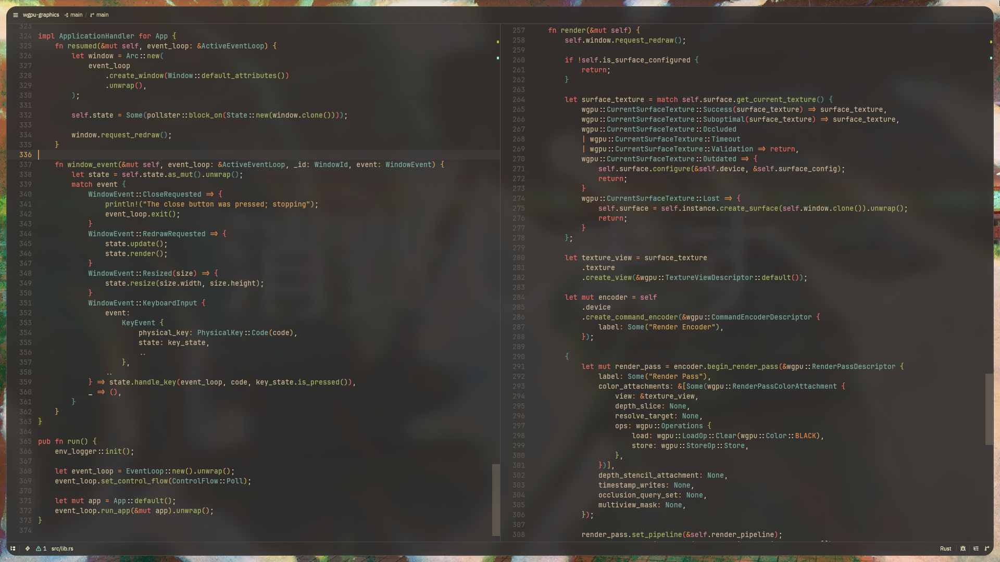
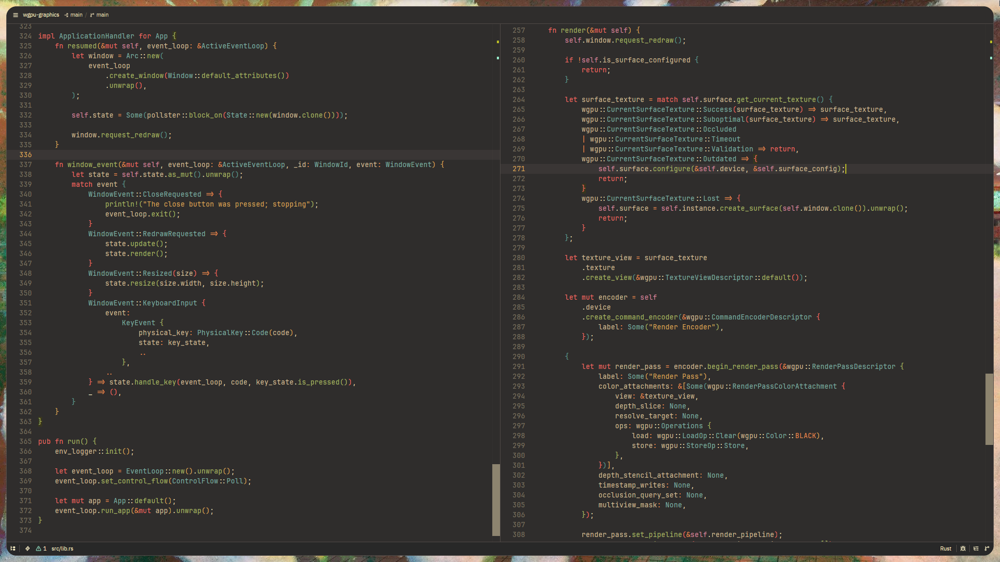

# Gruvbox Glass



### Solid version



### Settings

For a better experience, enable:

- Colorize Brackets
- Cursor Animation

### Troubleshooting

#### Transparency not working on niri

If you are using [niri](https://github.com/YaLTeR/niri), the window's `focus-ring` is drawn **behind** the window and shows through transparent areas, which overrides Zed's background. Because of this, the glass (transparent) effect will not look right until the focus ring is disabled or made transparent.

To fix it, edit your niri config (`~/.config/niri/config.kdl`) and update the `focus-ring`

**Option 1: Disable the focus ring**

```kdl
focus-ring {
    off
}
```

**Option 2: Keep the ring but make it transparent**

```kdl
focus-ring {
    width 0
    active-color "#00000000"
}
```

> **Note:** This only affects the transparent variant (**Gruvbox Glass**). The opaque variant (**Gruvbox Glass Matte**) is not affected.
